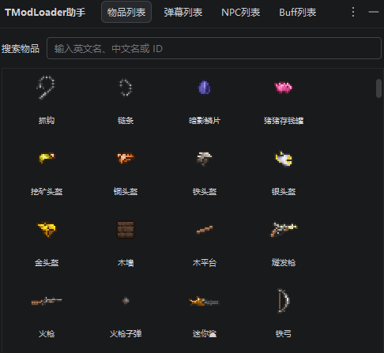

# tModLoader助手 | tModLoader Helper
Rider 插件，专为 tModLoader 泰拉瑞亚模组开发者打造。

> 在Rider内置可视化实体数据库面板 + C#中文关键词代码补全，不用来回切Wiki查ID！

## ✨ 功能介绍
### 🪟 侧边常驻工具窗口（ToolWindow）
Rider右侧工具栏点击图标，直接打开TModLoader助手面板。
- 多标签页快速切换：**物品列表 / 弹幕列表 / NPC列表**
- 像素风格网格画廊，直接预览游戏内原图图标
- 搜索框支持模糊检索：**中文名、英文字段名、数字ID**，三者均可搜索

### ⌨️ C# 智能代码补全（核心亮点）
在C#代码中输入 `ItemID.` / `NPCID.` / `BuffID.` / `ProjectileID.`
直接输入中文关键词（例如输入`木`），补全下拉列表自动匹配。
候选项展示：
- 英文字段名
- 游戏中文名称
- 对应数字ID

## 📸 界面预览

> 右侧Rider侧边面板，列表显示对应东西，支持搜索。

## 📌 使用教程
1. 安装插件后，Rider右侧边栏会出现TModLoader助手图标，点击打开面板
2. 在面板顶部搜索框输入中文/英文/ID，实时筛选物品、NPC、弹幕
3. 在代码编辑器输入`ItemID.`，接着输入中文关键词，唤起中文补全候选项

## 📋 数据库来源
数据提取自原版tModLoader源码，包含泰拉瑞亚原版全部物品、NPC、弹幕、Buff信息。

## 🧩 兼容性
- IDE：Rider
- 项目：tModLoader C# 模组项目

## ⚠️ 版权声明
本项目仅作为tModLoader模组开发辅助工具，**非Re-Logic官方工具，与泰拉瑞亚、tModLoader官方无关**。
游戏素材版权归Re-Logic所有，仅用于本地开发预览。

## 📥 安装方式
1. 插件市场：JetBrains Marketplace搜索 `tModLoader Helper`
2. 本地安装：下载插件zip包 → Rider设置 → Plugins → Install Plugin from Disk
